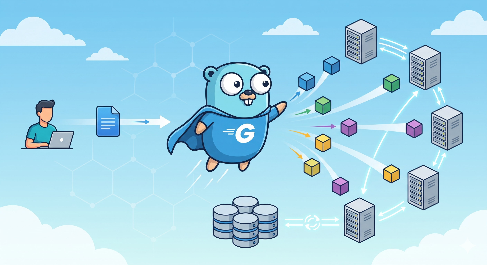
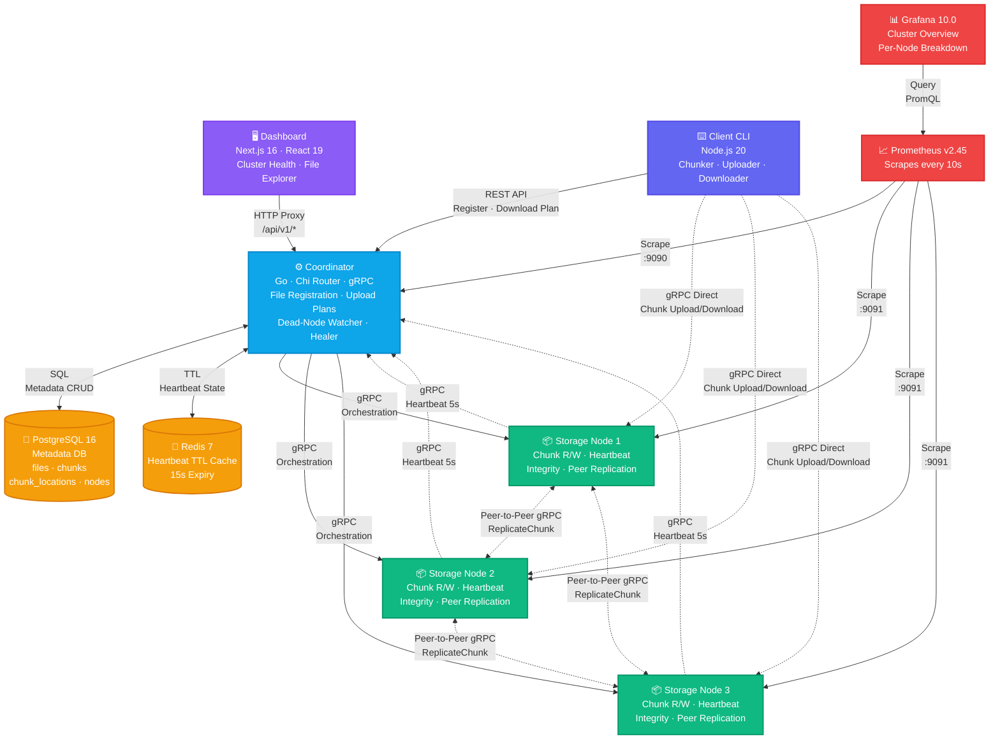

<div align="center">

# ☁️ Distributed Cloud Storage

### A production-grade distributed file storage system built from scratch

[](https://github.com/viki-777/distributed-cloud-storage/actions/workflows/ci.yml)


<br/>

**Chunk files across multiple nodes · 3× automatic replication · Self-healing on failure · Real-time monitoring**

<br/>



</div>

---

## 📖 Project Overview

**Distributed Cloud Storage (DCS)** is a fault-tolerant, distributed file storage system inspired by the **Google File System (GFS)**. It splits files into 64 MB chunks, distributes them across multiple storage nodes with **3× replication**, and automatically heals itself when nodes go down — all orchestrated through a central coordinator.

The system demonstrates real-world distributed systems concepts including **chunk-based storage**, **peer-to-peer replication**, **heartbeat-based health monitoring**, **automatic failure recovery**, and **observability** — backed by a modern web dashboard for cluster management.

### Why This Project?

| Problem | DCS Solution |
|---|---|
| Single-server storage is a single point of failure | Data replicated across **3 independent nodes** |
| Large file transfers are slow and unreliable | Files **chunked into 64 MB pieces**, uploaded **in parallel** |
| Node crashes cause data loss | **Automatic re-replication** restores the replication factor |
| No visibility into cluster health | **Grafana dashboards** + **Prometheus metrics** + **real-time web UI** |
| Complex setup for distributed systems | **Single `docker-compose up`** brings the entire cluster online |

---

## 🏗️ System Architecture



### Data Flow

<details>
<summary><b>📤 Upload Flow</b></summary>

```
1. Client splits file into 64 MB chunks (SHA-256 checksums)
2. Client registers the file with the Coordinator via REST
3. Coordinator generates an upload plan (chunk → node mapping, 3 copies each)
4. Client uploads chunks DIRECTLY to Storage Nodes via gRPC (parallel, max 5)
5. Each node confirms storage back to the Coordinator
6. Coordinator updates metadata in PostgreSQL
```

</details>

<details>
<summary><b>📥 Download Flow</b></summary>

```
1. Client requests file metadata from the Coordinator via REST
2. Coordinator returns a download plan (chunk → available nodes)
3. Client fetches chunks in parallel directly from Storage Nodes via gRPC
4. Client reassembles chunks in order and verifies the final checksum
```

</details>

<details>
<summary><b>💓 Heartbeat & Healing Flow</b></summary>

```
1. Each Storage Node pings the Coordinator via gRPC every 5 seconds
2. Coordinator stores heartbeat in Redis with a 15-second TTL
3. Watcher goroutine polls every 10 seconds for expired TTLs
4. Dead node detected → Coordinator finds under-replicated chunks
5. Coordinator instructs healthy nodes to replicate via peer-to-peer gRPC
6. Database updated with new chunk locations
```

</details>

---

## ✨ Key Features

### Core Storage Engine
- **📦 Chunked Storage** — Files split into **64 MB chunks** with SHA-256 checksums for integrity
- **🔄 3× Replication** — Every chunk automatically stored on **3 different nodes** for durability
- **⚡ Parallel Transfers** — Upload and download chunks **concurrently** (up to 5 in parallel)
- **🔗 Direct Data Path** — Client transfers data **directly to/from nodes**, coordinator handles only metadata

### Fault Tolerance & Self-Healing
- **💓 Heartbeat Monitoring** — Storage nodes ping every 5s; Redis TTL detects failures within 15s
- **🔧 Automatic Re-Replication** — Dead node detected → orphaned chunks re-replicated to healthy peers
- **🛡️ Integrity Verification** — Background SHA-256 verification catches silent data corruption
- **🚰 Graceful Node Draining** — Safely decommission nodes without data loss

### Observability & Dashboard
- **📊 Real-Time Dashboard** — Next.js web UI with cluster health, node grid, file explorer, and chunk maps
- **📈 Prometheus Metrics** — Track active nodes, chunk counts, replication status, disk usage, and heal events
- **📉 Grafana Dashboards** — Pre-built **Cluster Overview** and **Per-Node Breakdown** dashboards
- **🌗 Dark/Light Mode** — Dashboard supports both themes with smooth toggle

### Developer Experience
- **🐳 One-Command Setup** — `docker-compose up` launches the entire 7-service cluster
- **🧪 Stress Testing** — Built-in 512 MB upload stress test with RAM monitoring
- **🔌 gRPC + REST APIs** — Clean, well-defined interfaces with Protobuf contracts
- **⚙️ CI/CD Pipeline** — GitHub Actions for Go vet/test, npm test, and Docker builds

---

## 🛠️ Technology Stack

<table>
<tr>
<th>Layer</th>
<th>Technology</th>
<th>Purpose</th>
</tr>
<tr>
<td rowspan="5"><b>Backend</b></td>
<td></td>
<td>Coordinator + Storage Nodes</td>
</tr>
<tr>
<td></td>
<td>HTTP router for REST API</td>
</tr>
<tr>
<td></td>
<td>Internal node communication + chunk transfers</td>
</tr>
<tr>
<td></td>
<td>Service definitions (ChunkService, NodeService)</td>
</tr>
<tr>
<td></td>
<td>Metrics exposition</td>
</tr>
<tr>
<td rowspan="2"><b>CLI Client</b></td>
<td></td>
<td>CLI runtime</td>
</tr>
<tr>
<td></td>
<td>Command-line interface framework</td>
</tr>
<tr>
<td rowspan="4"><b>Dashboard</b></td>
<td></td>
<td>Full-stack React framework (App Router)</td>
</tr>
<tr>
<td></td>
<td>UI library</td>
</tr>
<tr>
<td></td>
<td>Utility-first styling</td>
</tr>
<tr>
<td></td>
<td>Accessible component library</td>
</tr>
<tr>
<td rowspan="2"><b>Data Store</b></td>
<td></td>
<td>Metadata storage (files, chunks, nodes)</td>
</tr>
<tr>
<td></td>
<td>Heartbeat TTL cache</td>
</tr>
<tr>
<td rowspan="2"><b>Monitoring</b></td>
<td></td>
<td>Metrics collection (scrapes every 10s)</td>
</tr>
<tr>
<td></td>
<td>Pre-built cluster & node dashboards</td>
</tr>
<tr>
<td rowspan="2"><b>DevOps</b></td>
<td></td>
<td>Multi-container orchestration</td>
</tr>
<tr>
<td></td>
<td>Automated testing & Docker builds</td>
</tr>
</table>

---

## 🚀 Getting Started

### Prerequisites

- [Docker](https://docs.docker.com/get-docker/) & [Docker Compose](https://docs.docker.com/compose/install/)
- [Node.js 20+](https://nodejs.org/) (for the CLI client & dashboard)
- [Go 1.25+](https://golang.org/dl/) (only if building from source)

### 1. Clone the Repository

```bash
git clone https://github.com/viki-777/distributed-cloud-storage.git
cd distributed-cloud-storage
```

### 2. Launch the Cluster

A single command brings up the entire infrastructure — PostgreSQL, Redis, Coordinator, 3 Storage Nodes, Prometheus, and Grafana:

```bash
docker-compose up --build
```

> **🕐 First build takes a few minutes.** Subsequent launches use cached layers.

Once running, you'll have:

| Service | URL | Description |
|---|---|---|
| **Coordinator REST API** | `http://localhost:8080` | File registration, node management |
| **Coordinator gRPC** | `localhost:50050` | Internal node communication |
| **Storage Node 1** | `localhost:50051` | Chunk storage (gRPC) |
| **Storage Node 2** | `localhost:50052` | Chunk storage (gRPC) |
| **Storage Node 3** | `localhost:50053` | Chunk storage (gRPC) |
| **Prometheus** | `http://localhost:9092` | Metrics & queries |
| **Grafana** | `http://localhost:3001` | Dashboards (admin/admin) |

### 3. Start the Dashboard

```bash
cd dashboard
npm install
npm run dev
```

Open [http://localhost:3000](http://localhost:3000) to access the cluster management dashboard.

### 4. Use the CLI Client

```bash
cd client
npm install
```

**Upload a file:**

```bash
node src/cli.js upload ./my-large-file.zip
```

**Download a file:**

```bash
node src/cli.js download <file-id> -o ./downloaded-file.zip
```

### 5. Run Stress Tests

```bash
bash scripts/stress-test-upload.sh
```

> Creates a 512 MB test file, uploads it with RAM monitoring (verifies < 300 MB peak usage), downloads, and verifies checksum integrity.

---

## 🔌 API Reference

### REST API (Coordinator)

| Method | Endpoint | Description |
|---|---|---|
| `GET` | `/api/v1/health` | Health check |
| `GET` | `/api/v1/files/` | List all files |
| `POST` | `/api/v1/files/register` | Register file & get upload plan |
| `GET` | `/api/v1/files/{fileID}` | Get file metadata + download plan |
| `GET` | `/api/v1/files/{fileID}/chunk_map` | Chunk → node mapping |
| `POST` | `/api/v1/files/{fileID}/chunks/{chunkID}/confirm` | Confirm chunk stored |
| `POST` | `/api/v1/chunks/{chunkID}/corrupted` | Report chunk corruption |
| `GET` | `/api/v1/nodes/` | List all nodes |
| `POST` | `/api/v1/nodes/register` | Register a new node |
| `POST` | `/api/v1/nodes/{nodeID}/drain` | Gracefully drain a node |
| `GET` | `/api/v1/dashboard/summary` | Dashboard summary stats |

### gRPC Services

**ChunkService** — `UploadChunk` · `DownloadChunk` · `DeleteChunk` · `VerifyChunk`

**NodeService** — `Heartbeat` · `ReplicateChunk`

---

## 📊 Database Schema

```sql
files           chunks              chunk_locations         nodes
┌────────────┐  ┌───────────────┐   ┌──────────────────┐   ┌──────────────────┐
│ id (UUID)  │  │ id            │   │ id               │   │ id               │
│ name       │  │ file_id (FK)  │   │ chunk_id (FK)    │   │ address          │
│ size_bytes │  │ chunk_index   │   │ node_id          │   │ available_bytes  │
│ chunk_size │  │ chunk_id      │   │ status           │   │ used_bytes       │
│ total_chunk│  │ size_bytes    │   │ stored_at        │   │ status           │
│ checksum   │  │ checksum      │   └──────────────────┘   │ last_heartbeat   │
│ is_encrypt │  └───────────────┘                          └──────────────────┘
│ status     │
└────────────┘
```

---

## 📈 Monitoring & Observability

### Prometheus Metrics

| Metric | Type | Source |
|---|---|---|
| `dcs_active_nodes_total` | Gauge | Coordinator |
| `dcs_chunks_total` | Gauge | Coordinator |
| `dcs_under_replicated_chunks` | Gauge | Coordinator |
| `dcs_upload_operations_total` | Counter | Coordinator |
| `dcs_heal_events_total` | Counter | Coordinator |
| `dcs_node_chunks_stored` | Gauge | Storage Node |
| `dcs_node_disk_used_bytes` | Gauge | Storage Node |
| `dcs_node_disk_free_bytes` | Gauge | Storage Node |
| `dcs_grpc_requests_total` | Counter | Storage Node |

### Grafana Dashboards

Access Grafana at [http://localhost:3001](http://localhost:3001) (credentials: `admin` / `admin`):

- **Cluster Overview** — Active nodes, total chunks, replication health, heal events
- **Per-Node Breakdown** — Individual node disk usage, chunk count, gRPC request rate

---

## 📚 Documentation

| Document | Description |
|---|---|
| [`DFS_IMPLEMENTATION_PLAN.md`](DFS_IMPLEMENTATION_PLAN.md) | Full 4-phase implementation plan |
| [`docs/ADR-001-go-for-daemons.md`](docs/ADR-001-go-for-daemons.md) | Why Go for backend services |
| [`docs/ADR-002-grpc-internal.md`](docs/ADR-002-grpc-internal.md) | Why gRPC for internal communication |
| [`docs/ADR-003-replication-strategy.md`](docs/ADR-003-replication-strategy.md) | 3× replication design rationale |
| [`docs/algorithms-and-concepts-deep-dive.md`](docs/algorithms-and-concepts-deep-dive.md) | Distributed systems concepts |
| [`docs/distributed-cloud-storage-interview-bible.md`](docs/distributed-cloud-storage-interview-bible.md) | Interview preparation guide |

---

## 🗺️ Roadmap

- [x] **Phase 1** — Core upload/download across 3 nodes
- [x] **Phase 2** — Fault tolerance & auto-healing
- [x] **Phase 3** — Dashboard + Prometheus/Grafana monitoring
- [ ] **Phase 4** — Kubernetes deployment, JWT authentication, production hardening

### Future Improvements

- 🔐 **JWT Authentication** — Secure API endpoints
- ☸️ **Kubernetes Manifests** — StatefulSets for nodes, Deployments for coordinator
- 🧮 **Erasure Coding** — Reed-Solomon to reduce storage overhead from 3× to ~1.5×
- 🗳️ **Raft Consensus** — Eliminate coordinator as single point of failure
- 🌐 **Decentralized Node Discovery** — Internet-facing node registration
- 🗄️ **Tiered Storage** — Hot/warm/cold data placement

---

## 📝 Summary

**Distributed Cloud Storage** is a comprehensive distributed file storage system that demonstrates production-level distributed systems engineering. Built with **Go** for high-performance backend services, **gRPC** for efficient internal communication, and a modern **Next.js** dashboard for cluster management, it implements the core principles of the Google File System:

| Principle | Implementation |
|---|---|
| **Reliability** | 3× replication across independent nodes ensures data survives node failures |
| **Performance** | 64 MB chunking + parallel transfers maximize throughput for large files |
| **Self-Healing** | Heartbeat monitoring + automatic re-replication restore durability without manual intervention |
| **Observability** | Prometheus metrics + Grafana dashboards + real-time web UI provide full cluster visibility |
| **Simplicity** | Single `docker-compose up` command deploys the entire 7-service cluster |

The system serves as both a **functional distributed storage solution** and a **deep learning resource** for understanding how large-scale distributed storage systems work under the hood.

---

<div align="center">

Built with ❤️ by [Vikash](https://github.com/viki-777)

**⭐ Star this repo if you find it useful!**

</div>
